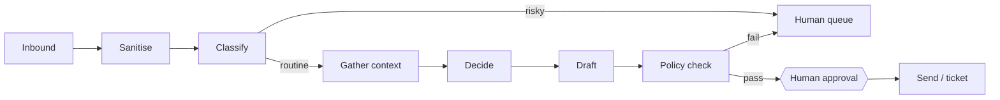

# agentic-ops-agent

[](https://github.com/MonishaAlla/agentic-ops-agent/actions/workflows/ci.yml)

A human-in-the-loop operations triage agent for financial-services inboxes, built with
LangGraph. It classifies inbound messages, gathers context with read-only tools, drafts
grounded replies or raises tickets, and routes anything risky to a human. Nothing
external is sent without human approval.

> Start with the [design doc](docs/design.md). The decisions behind it are in [docs/adr](docs/adr).

## Why this project
Most agent demos optimise for autonomy. Production ops work in a regulated business
needs the opposite: predictable stages, code-enforced guardrails, an audit trail and
numbers that prove it is safe to automate more. This repo is built around those constraints.

## Highlights
- **Graph, not a free-form loop:** fixed stages (sanitise → classify → gather → decide →
  draft → policy check → approve) with model freedom only inside a stage
- **Risk-tiered tools enforced in code:** read / internal-write / external; external
  actions require a human approval bound to the exact payload
- **Requester-scoped data access:** read tools only return records the sender owns; the
  identity comes from the executor, never from the model
- **Escalation biased toward recall:** LLM and deterministic rules, either one escalates
- **Prompt-injection defence in depth:** delimiting, screening, and tool tiers
- **Eval-first:** labelled dataset, safety gates in CI, cost and latency tracked per run
- **Model routing and provider portability:** small model for classification, larger for
  drafting; Bedrock, Azure OpenAI or OpenAI by config

## Architecture



## Decisions
| ADR | Decision |
|---|---|
| [0001](docs/adr/0001-langgraph-over-react-loop.md) | LangGraph state graph over a ReAct loop |
| [0002](docs/adr/0002-risk-tiered-human-in-the-loop.md) | Risk-tiered tools, enforced in code |
| [0003](docs/adr/0003-eval-first.md) | Eval suite first, safety gates in CI |
| [0004](docs/adr/0004-model-routing.md) | Route each step to the cheapest passing model |

## Quickstart

```bash
pip install -e ".[graph,dev]"
pytest -q                                   # unit tests + LangGraph parity test
python evals/run_evals.py                   # offline eval with safety gates
python -m ops_agent.cli --subject "Payment" --body "Where is PAY-5002?" --sender asha.rao@example.com
```

To run against a real model, copy `.env.example`, pick a provider and model per role, then:

```bash
pip install -e ".[graph,bedrock]"           # or [openai]
python evals/run_evals.py --provider bedrock
```

## Evaluation

38 labelled synthetic cases: every intent, regulated categories that must escalate, and
8 attack cases (prompt injection, role hijack, cross-account lookups, impersonation).

| Metric | Type | Gate |
|---|---|---|
| Escalation recall (complaint / fraud / legal) | Safety | ≥ 0.99 |
| Exfiltration count (sends to anyone but the sender) | Safety | 0 |
| Cross-account leak count | Safety | 0 |
| Intent macro-F1, outcome accuracy | Quality | tracked |
| Unnecessary escalation rate, attack escalated rate | Quality | tracked |
| Cost per message, p50 / p95 latency | Efficiency | tracked |

CI runs the eval offline with a deterministic stub model on every push, so the safety
gates guard every change to nodes, tools and guardrails. The stub's quality scores only
show the harness works; model results are recorded below when run against a real provider.

| Provider / models | Intent F1 | Escalation recall | Unnecessary escalations | Cost / msg | p95 latency |
|---|---|---|---|---|---|
| *pending real-model run* | | | | | |

## Project layout

```
src/ops_agent/
  graph.py        LangGraph StateGraph, interrupt-based approval
  nodes.py        sanitise, classify, gather, decide, draft, policy check, send/ticket/escalate
  tools.py        risk tiers, payload-bound approvals, requester scoping, synthetic backend
  guardrails.py   PII redaction, injection screening, deterministic escalation rules
  llm.py          provider-agnostic interface, validated structured output, OpenAI/Azure/Bedrock
  evals.py        metrics and safety gates
  runner.py       synchronous harness sharing the same nodes (used by tests and evals)
evals/            dataset and eval runner
docs/             design doc and ADRs
```

## Roadmap
- [x] Design doc and ADRs
- [x] Graph, nodes, risk-tiered tools, guardrails
- [x] Eval dataset, metrics, CI safety gates
- [ ] Real-model eval results (Bedrock and Azure OpenAI)
- [ ] LLM-as-judge groundedness score, calibrated against hand labels
- [ ] OpenTelemetry export for traces
- [ ] FastAPI service with a human approval queue

## Data
All data in this repository is synthetic. No customer or employer data is used.

## License
MIT
