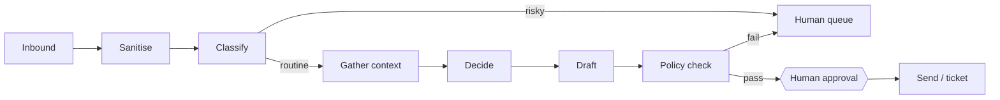

# agentic-ops-agent

A human-in-the-loop operations triage agent for financial-services inboxes, built with
LangGraph. It classifies inbound messages, gathers context with read-only tools, drafts
grounded replies or raises tickets, and routes anything risky to a human. Nothing
external is sent without human approval.

> **Status:** design complete, implementation in progress.
> Start with the [design doc](docs/design.md).

## Why this project
Most agent demos optimise for autonomy. Production ops work in a regulated business
needs the opposite: predictable stages, code-enforced guardrails, an audit trail and
numbers that prove it is safe to automate more. This repo is built around those constraints.

## Highlights
- **Graph, not a free-form loop:** fixed stages (sanitise → classify → gather → decide →
  draft → policy check → approve) with model freedom only inside a stage
- **Risk-tiered tools enforced in code:** read / internal-write / external; external
  actions require a human approval bound to the exact payload
- **Escalation biased toward recall:** LLM and deterministic rules, either one escalates
- **Prompt-injection defence in depth:** delimiting, screening, and tool tiers
- **Eval-first:** labelled dataset, safety gates in CI, cost and latency tracked per run
- **Model routing and provider portability:** small model for classification, larger for
  drafting; Bedrock, Azure OpenAI or OpenAI by config

## Architecture

## Decisions
| ADR | Decision |
|---|---|
| [0001](docs/adr/0001-langgraph-over-react-loop.md) | LangGraph state graph over a ReAct loop |
| [0002](docs/adr/0002-risk-tiered-human-in-the-loop.md) | Risk-tiered tools, enforced in code |
| [0003](docs/adr/0003-eval-first.md) | Eval suite first, safety gates in CI |
| [0004](docs/adr/0004-model-routing.md) | Route each step to the cheapest passing model |

## Roadmap
- [x] Design doc and ADRs
- [ ] Graph, state and nodes
- [ ] Tools with risk tiers and approval binding
- [ ] Synthetic eval dataset and eval runner
- [ ] Tracing, cost and latency reporting
- [ ] CI with safety gates
- [ ] Eval results table in this README

## Data
All data in this repository is synthetic. No customer or employer data is used.

## License
MIT
