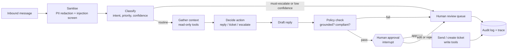

# Design: Agentic Operations Triage Agent

**Status:** Accepted · **Author:** Monisha Alla

## 1. Problem

Operations teams in financial services get hundreds of inbound emails a day: payment
queries, account-status requests, document submissions, complaints and escalations.
Analysts read each email, decide what it is, look up data in two or three systems,
then reply or raise a ticket. Most of that work is repetitive, but some of it is
high-risk: a wrong reply about a payment or a missed complaint has regulatory cost.

**Goal:** automate the repetitive 70–80% end to end, and route everything risky to a human
with the context already gathered, without ever letting the agent take an irreversible
external action on its own.

### Non-goals
- Fully autonomous replies to customers. Every external send is human-approved in v1.
- Replacing the system of record. The agent reads from and writes to existing systems
  through narrow tools.
- Training custom models. Off-the-shelf LLMs, with prompts, structured outputs and evals.

## 2. Requirements

| Type | Requirement | Target |
|---|---|---|
| Functional | Classify intent and priority of each inbound message | Macro-F1 ≥ 0.90 on the eval set |
| Functional | Gather context with read-only tools before deciding | — |
| Functional | Draft a grounded reply or create a ticket | Groundedness ≥ 0.95 |
| Safety | Never miss a must-escalate case (complaint, fraud, legal) | Escalation recall ≥ 0.99 |
| Safety | Prompt injection never causes data to leave to a third party | 0 exfiltrations, 0 cross-account leaks |
| Safety | A customer only ever sees data about their own accounts | Enforced in the tool layer |
| Safety | No PII sent to the model beyond what the task needs | Redaction before every LLM call |
| Cost | Average cost per message | < $0.01 |
| Latency | End-to-end, excluding human wait | p95 < 8 s |
| Ops | Every step traced and replayable | 100% of runs |

The safety rows are hard gates; the others are targets we trade off against each other.

## 3. Architecture

The agent is a LangGraph `StateGraph`. Each box is a node; the state carries the message,
redaction map, classification, tool results, draft, policy verdict and an audit trail.

### Why a graph and not a free-form ReAct loop
A ReAct loop lets the model decide the next step every time. That is flexible but hard
to bound: it can loop, skip the policy check, or call a write tool early. Ops work has a
known shape, so the graph fixes the *order of stages* and gives the model freedom only
*inside* a stage (which read tools to call, what to write). See
[ADR-0001](adr/0001-langgraph-over-react-loop.md).

## 4. Key design decisions

### 4.1 Tools are tiered by risk
| Tier | Examples | Who can trigger |
|---|---|---|
| Read | `get_account_status`, `get_payment_status`, `search_kb` | Agent, freely |
| Internal write | `create_ticket`, `add_note` | Agent, logged |
| External / irreversible | `send_reply` | Only after human approval (graph interrupt) |

The tier is enforced in code (the tool executor checks it), not in the prompt. A prompt
instruction can be overridden by an injected email; a code check cannot.

Read tools are also **scoped to the requester**: the executor passes the sender's identity
to the tool, and the tool only returns records that sender owns. The model never supplies
the identity, so it cannot be talked into looking up someone else's account. The reply
recipient is likewise set by code to the original sender.
See [ADR-0002](adr/0002-risk-tiered-human-in-the-loop.md).

### 4.2 Escalation is biased toward recall
Missing a complaint costs far more than sending an easy email to a human. So escalation
uses two independent signals, either of which escalates: an LLM classification, and
a deterministic keyword/regex rule set for regulated categories (complaint, fraud,
legal threat). The cost is extra human reviews, which we measure as the
*unnecessary escalation rate* and keep below 15%.

### 4.3 Untrusted content is data, never instructions
Email bodies are wrapped in delimiters and the system prompt states that they are data.
On top of that, a screening step flags known injection patterns, and the risk tiers mean
a successful injection still cannot send anything. Defence in depth, not one clever prompt.

### 4.4 Model routing
Classification is a short structured-output call and goes to a small, cheap model.
Reply drafting needs better writing and reasoning and goes to a larger model. Most
messages only need classification and a template-style reply, so this should cut cost
per message well below a large-model-everywhere baseline; the eval report records
the measured difference.
See [ADR-0004](adr/0004-model-routing.md).

### 4.5 Model-agnostic
The LLM sits behind a small interface, so Amazon Bedrock, Azure OpenAI, OpenAI or a local
model can be swapped by config. The eval suite is what tells us whether a swap is safe.

## 5. Evaluation

Evals are written before prompts are tuned ([ADR-0003](adr/0003-eval-first.md)).

- **Dataset:** labelled synthetic ops messages covering every intent, every priority,
  must-escalate cases and prompt-injection attacks. No real customer data.
- **Metrics:** intent macro-F1, outcome accuracy, escalation recall, unnecessary-escalation
  rate, attack-escalated rate, exfiltration count, cross-account leak count, cost per
  message, p50/p95 latency. Reply groundedness is enforced per message by the policy check
  (every cited fact must come from a tool result) and will get an LLM-judge score later.
- **Regression gate:** CI runs the offline eval on every change to prompts, tools or
  model config, and fails the build if a safety metric drops below its gate.

## 6. Failure modes

| Failure | Mitigation |
|---|---|
| LLM returns malformed output | Pydantic-validated structured output; one retry; then escalate |
| LLM provider down or slow | Timeout + retry with backoff; fall back to the secondary provider; else queue for human |
| Tool error or timeout | Tool result marked failed; agent must not invent data; escalate with partial context |
| Prompt injection | Delimiting, screening, code-enforced tool tiers, human approval on sends |
| Hallucinated facts in reply | Policy check requires every claim to trace to a tool result; fail → human |
| Drift in incoming mail | Weekly sample of production traffic labelled and added to the eval set |

## 7. Observability

Every run emits a trace (node, inputs, outputs, tokens, cost, latency) and an audit
record (what the agent saw, decided and did, and who approved). Traces are what make a
bad decision debuggable and replayable; the audit record is what compliance asks for.

## 8. Rollout plan

1. **Shadow mode:** agent runs on live traffic, humans work as usual, outputs compared.
2. **Assist mode:** agent drafts, humans approve every send (this design).
3. **Selective autonomy:** auto-send only for intents with a sustained track record,
   behind a feature flag, with sampling-based human audit.

## 9. Open questions
- Which intents, if any, meet the bar for selective autonomy, and who signs that off?
- Retention period for traces that contain redacted message content.
